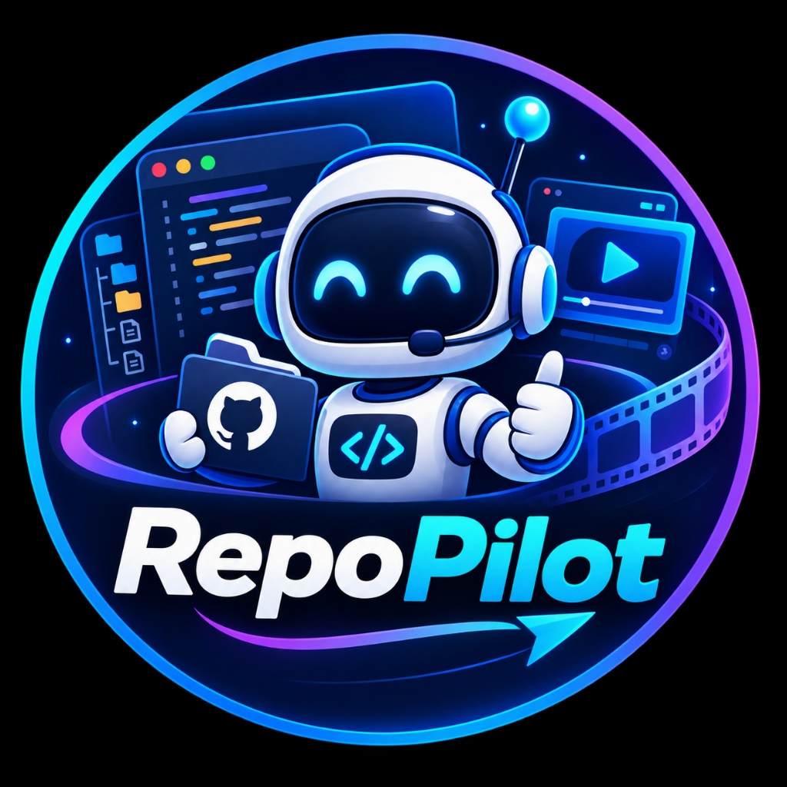

<div align="center">



# RepoPilot

**Turn any GitHub repository into a cinematic, voice-narrated demo video — in minutes.**

[](https://repo-pilot-nine-nu.vercel.app)
[](LICENSE)

<p>
  
  
  
  
  
  
  
  
  
  
  
</p>

</div>

---

##  The Problem: The "Showcase" Wall

Great developers are often terrible marketers. You spend hundreds of hours building an incredible open-source tool, but when it's time to share it with the world, you just drop a link to a dense, text-heavy README. 

People don't want to read source code to understand why your project is cool. They want to *see* it. But creating a professional demo video requires writing a script, recording a high-quality voiceover, editing timing, adding overlays, and mastering complex software like Premiere Pro. It's exhausting. 

**RepoPilot breaks down the showcase wall.**

---

## 🎬 The Solution: Your Personal AI Film Studio

RepoPilot is an autonomous AI-powered studio that eliminates the friction of creating high-quality developer demo videos. 

Just paste a GitHub URL — our AI agents will instantly deep-dive into your codebase, understand your architecture, craft a compelling narrative, generate a studio-quality neural voiceover, and produce a professional green-screen demo video.

**No video editing skills required. Just your code.**

---

## 🚀 How it Works (in 4 Steps)

Using RepoPilot takes less than 2 minutes:

1. **Connect & Analyze:** Paste any public GitHub repository URL into the dashboard. RepoPilot's AI agents will read the code, detect the tech stack, and understand the core features.
2. **Choose an Angle:** Pick a narrative style (e.g., "The Technical Deep-Dive" or "The Origin Story"). The AI will generate a synchronized scene-by-scene script.
3. **Edit & Direct:** The developer has full control! You can edit the script yourself, or chat with the AI Director Agent to tweak the tone, add custom notes, and refine the scenes until they are perfect.
4. **Generate & Export:** Pick an AI voice, generate the audio, and hit **Export MP4** to render your cinematic green-screen template!

---

## ⚡ Features

| Feature | Description |
|---|---|
| **Projects Dashboard** | Manage all your generated videos in one place with a sleek interface and soft-delete capabilities |
| **Download Assets (.ZIP)** | Instantly download your generated scripts and high-quality MP3 voiceovers as a ZIP archive to use in any external video editor |
| **Custom UI/UX Polish** | Features sleek, animated Tailwind CSS toast notifications instead of clunky native browser alerts |
| **Mobile-Ready Studio** | Fully responsive design ensures the script editor and AI director work flawlessly on phones and tablets |
| **Autonomous Codebase Analysis** | Deep-dives into your repo via the GitHub API to understand features, architecture, and value |
| **AI Narrative Generation** | Creates tailored story angles — "The Setup", "Feature Deep-Dive", "The Origin Story" — and writes synchronized scripts |
| **Neural Voiceovers** | Generates studio-quality TTS audio with multiple voice profiles and adjustable pitch |
| **Live Preview Engine** | Interactive Remotion-powered player — preview timing, text overlays, and audio in real-time |
| **Green Screen Export** | Exports a pristine `#00FF00` chroma-key MP4 ready to drop into Premiere Pro, CapCut, or DaVinci |
| **Multi-Format Rendering** | Landscape (16:9) for YouTube/ProductHunt or Portrait (9:16) for TikTok/Reels |
| **Secure OAuth** | Sign in with GitHub — no passwords stored, ever |

---

## 🏗️ Architecture

RepoPilot is built on a modern, decoupled stack designed for heavy AI workloads.

```
┌─────────────────────────────────────────────┐
│                   USER                       │
└──────────────────┬──────────────────────────┘
                   │  HTTPS
       ┌───────────▼───────────┐
       │   Next.js Frontend    │  ← Vercel
       │   (App Router, React) │
       │   Remotion Player     │
       │   NextAuth (OAuth)    │
       └───────────┬───────────┘
                   │  REST API + JWT Auth
       ┌───────────▼───────────┐
       │   FastAPI Backend     │  ← Render.com
       │   Python AI Agents    │
       │   Gemini LLM          │
       │   Edge TTS            │
       └───────────┬───────────┘
                   │  SQLAlchemy (pg8000)
       ┌───────────▼───────────┐
       │   Supabase (Postgres) │  ← Cloud DB
       └───────────────────────┘
```

---

## 💻 Local Development

You'll need both the Python backend and Next.js frontend running simultaneously.

### Prerequisites
- Python 3.9+
- Node.js 18+
- A [Supabase](https://supabase.com) project (free tier works)
- A [Gemini API key](https://ai.google.dev)

### 1. Clone the repository
```bash
git clone https://github.com/khushi-sharma2506/RepoPilot.git
cd RepoPilot
```

### 2. Configure the Backend
```bash
cd backend

# Create and activate a virtual environment
python -m venv venv
venv\Scripts\activate          # Windows
# source venv/bin/activate     # macOS/Linux

# Install dependencies
pip install -r requirements.txt
```

Create a `.env` file inside the `backend/` directory:
```env
GEMINI_API_KEY=your_gemini_api_key_here
DATABASE_URL=postgresql+pg8000://postgres:[password]@[host]:5432/postgres
NEXTAUTH_SECRET=your_secret_here
GITHUB_TOKEN=your_github_personal_access_token
```

```bash
# Start the FastAPI server
uvicorn main:app --reload --port 8000
```

### 3. Configure the Frontend
```bash
cd frontend
npm install
```

Create a `.env.local` file inside the `frontend/` directory:
```env
NEXT_PUBLIC_API_URL=http://localhost:8000/api
NEXTAUTH_URL=http://localhost:3000
NEXTAUTH_SECRET=your_secret_here
GITHUB_ID=your_github_oauth_app_id
GITHUB_SECRET=your_github_oauth_app_secret
GOOGLE_ID=your_google_client_id
GOOGLE_SECRET=your_google_client_secret
```

```bash
# Start the Next.js dev server
npm run dev
```

### 4. Open the Studio
Navigate to `http://localhost:3000`, sign in, paste any public GitHub URL, and let RepoPilot do the rest!

---

## ☁️ Deployment

| Service | Platform | Notes |
|---|---|---|
| Frontend | [Vercel](https://vercel.com) | Set root directory to `frontend` |
| Backend | [Render](https://render.com) | Set root directory to `backend`, start command: `uvicorn main:app --host 0.0.0.0 --port 10000` |
| Database | [Supabase](https://supabase.com) | Use the **Session Pooler** URL for Render compatibility |

> **Important**: Remember to update your Google and GitHub OAuth redirect URIs to include your production domain after deployment.

---

## 🤝 Contributing

Contributions are welcome! Please open an issue first to discuss what you'd like to change, then submit a pull request.

1. Fork the repository
2. Create your feature branch (`git checkout -b feature/amazing-feature`)
3. Commit your changes (`git commit -m 'feat: add amazing feature'`)
4. Push to the branch (`git push origin feature/amazing-feature`)
5. Open a Pull Request

---

## 📄 License

This project is licensed under the **MIT License** — see the [LICENSE](LICENSE) file for details.

---

<div align="center">

Developed by [Khushi Sharma](https://github.com/khushi-sharma2506)

</div>
